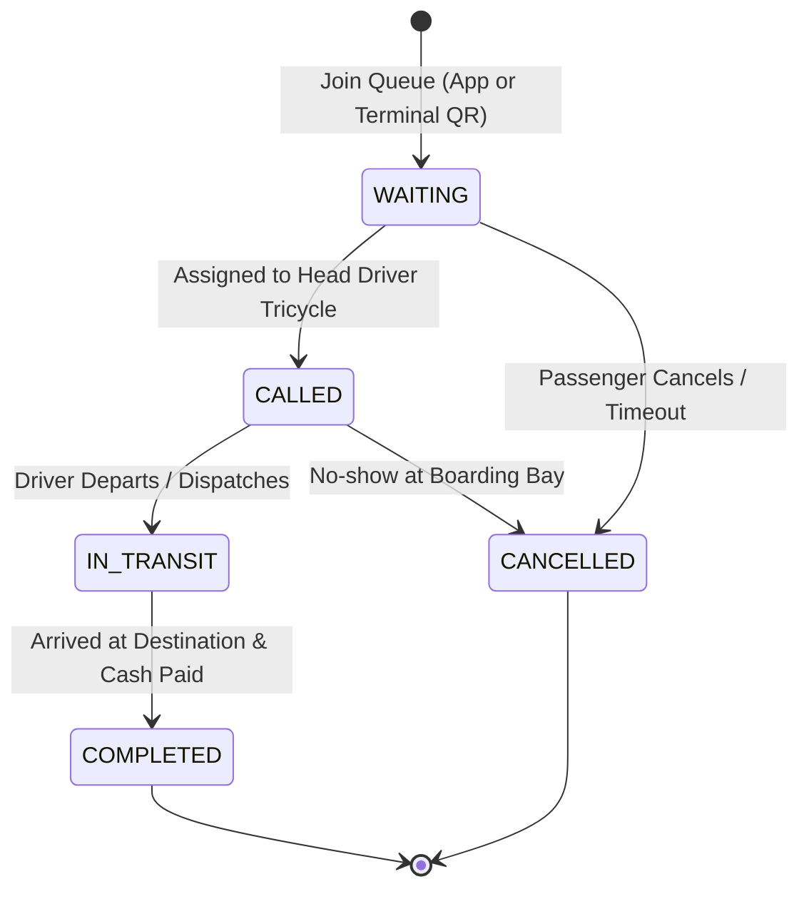

# 03 - Queue and Dispatch Lifecycle

## 1. Lifecycle Overview & Queue Philosophy
PilaGo digitalizes the physical *pila* into two interdependent queues managed at each terminal:
1. **The Passenger Queue:** Divided into **Regular (Shared)** and **Special (Solo)** streams.
2. **The Driver Queue:** A strict **FIFO (First-In, First-Out)** line where tricycle drivers take turns.

```
       [Passengers]                                          [Drivers]
  (Remote App / Walk-in QR)                             (Terminal Check-In)
             |                                                   |
             v                                                   v
   +--------------------+                              +--------------------+
   |  Passenger Queue   |                              |  Driver FIFO Queue |
   | (Regular / Special)|                              |  (Head of Line #1) |
   +--------------------+                              +--------------------+
             |                                                   |
             +-----------------------+---------------------------+
                                     |
                                     v
                       +---------------------------+
                       |   Boarding Bay Assignment  |
                       |  - Regular: 3-4 pax or    |
                       |    driver manual override |
                       |  - Special: 1 booking     |
                       +---------------------------+
                                     |
                                     v
                       +---------------------------+
                       |    Dispatch / In Transit  |
                       +---------------------------+
                                     |
                                     v
                       +---------------------------+
                       |  Cash Drop-off & Complete |
                       |  (Driver re-enters FIFO)  |
                       +---------------------------+
```

---

## 2. Queue Numbering Conventions
- **Regular Shared Trip:** Prefix `R-` followed by 3 digits (e.g., `R-101`, `R-102`). Resets daily per terminal.
- **Special Solo Trip:** Prefix `S-` followed by 3 digits (e.g., `S-042`).
- **Display Rule:** Always rendered in **large tabular numerals** using bold `Nunito Sans` (40–56px) so it is instantly legible in daylight and on public terminal TV monitors.

---

## 3. Passenger Queue State Machine

### States:
1. `WAITING`: Passenger joined queue. Receives live estimate of `people_ahead` and queue position.
2. `CALLED`: Assigned to a dispatched tricycle. Passenger is directed to the boarding bay. Body number displayed (e.g., "Board Tricycle #042").
3. `IN_TRANSIT`: Driver has confirmed passenger boarding and departed terminal.
4. `COMPLETED`: Passenger dropped off and fare paid.
5. `CANCELLED`: Passenger left queue before boarding or was marked no-show.



---

## 4. Driver FIFO State Machine & Dispatch Rules

### States:
1. `OFFLINE`: Driver is not working or not at the terminal.
2. `QUEUED`: Driver checked in at terminal. Placed at the tail of the FIFO queue.
3. `ASSIGNED`: Driver reached the front (#1) and is assigned a Special Trip or an active Regular Batch.
4. `ON_TRIP`: Tricycle dispatched with passengers en route to destinations.
5. `PAUSED`: Driver is on break/refueling; position in queue is paused or driver moves to end upon return.

### Regular Trip Batching & Dispatch Algorithm:
- **Default Tricycle Capacity:** 4 passengers.
- **Auto-Dispatch Trigger:** When 4 passengers for compatible/same-zone destinations are accumulated, the batch automatically locks and summons Driver #1.
- **Manual Driver Override ("Ready to Depart"):** If 2 or 3 passengers are boarded and the driver chooses not to wait for a 4th passenger, the driver clicks **"Dispatch Now"** in the Driver Portal. The system finalizes the batch immediately.

```python
def dispatch_next_regular_batch(terminal_id: int, driver_profile_id: int, manual_override: bool = False):
    """
    Evaluates waiting regular passengers for a terminal.
    If count >= 4 or (count >= 1 and manual_override):
        Assigns up to 4 passengers to Driver #1 in FIFO queue.
    """
    # 1. Fetch FIFO Head Driver
    driver = DriverProfile.objects.filter(
        terminal_id=terminal_id, 
        status=DriverStatus.QUEUED
    ).order_by('queue_entered_at').first()
    
    if not driver:
        return None # No driver available; passengers stay in WAITING
        
    waiting_entries = PassengerQueueEntry.objects.filter(
        terminal_id=terminal_id,
        trip_type=TripType.REGULAR,
        status=QueueStatus.WAITING
    ).order_by('joined_at')[:4]
    
    if len(waiting_entries) == 4 or (len(waiting_entries) > 0 and manual_override):
        # Create Dispatch Record
        dispatch = TripDispatch.objects.create(
            dispatch_number=generate_dispatch_number(),
            driver=driver,
            terminal_id=terminal_id,
            trip_type=TripType.REGULAR,
            total_fare=sum(entry.computed_fare for entry in waiting_entries)
        )
        dispatch.passenger_entries.set(waiting_entries)
        
        # Transition states
        waiting_entries.update(status=QueueStatus.CALLED, called_at=timezone.now())
        driver.status = DriverStatus.ASSIGNED
        driver.save()
        
        # Broadcast real-time WebSocket events
        notify_dispatch_event(dispatch)
        return dispatch
    return None
```

---

## 5. WebSocket Event Payloads

### 5.1 Passenger Live Update (`passenger_{user_id}`)
```json
{
  "event": "queue_update",
  "data": {
    "queue_number": "R-101",
    "status": "CALLED",
    "people_ahead": 0,
    "assigned_tricycle": {
      "body_number": "042",
      "plate_number": "ABC-1234",
      "driver_name": "Mang Pedro"
    },
    "message": "Your tricycle is ready at Boarding Bay 1!"
  }
}
```

### 5.2 Public Terminal TV Board (`terminal_{terminal_id}_board`)
```json
{
  "event": "board_refresh",
  "data": {
    "terminal_name": "Bayan Central Terminal",
    "now_serving_regular": ["R-098", "R-099", "R-100", "R-101"],
    "now_serving_special": ["S-041"],
    "dispatched_tricycle": {
      "body_number": "042",
      "destination": "Barangay San Isidro",
      "status": "BOARDING"
    },
    "waiting_count": 14,
    "available_drivers_count": 6,
    "updated_at": "2026-11-19T07:32:00Z"
  }
}
```
