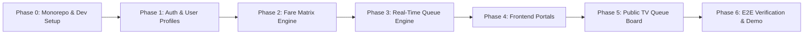

# PilaGo - Spec-Driven Implementation Plan

**Target Architecture:** Monorepo (`backend/` Django REST + Channels | `frontend/` React + Vite + Tailwind + shadcn/ui)  
**Design Guide:** [PilaGo Design System](../PilaGo_Design_System.md)  
**Status:** Approved & Ready for Execution  

---

## Roadmap & Milestones Overview



---

## Phase 0: Monorepo Foundation & Toolchain Setup
**Goal:** Initialize the project workspace, version control, and development environments for both Django and React.

### Deliverables:
1. **Directory Layout:**
   ```
   PilaGo/
   ├── backend/               # Django 5.x project
   │   ├── manage.py
   │   ├── pilago_core/       # Settings, ASGI/WSGI, root URLs
   │   ├── accounts/          # Auth, roles, discount verification
   │   ├── terminals/         # Terminals & destination fare matrix
   │   ├── drivers/           # Driver roster & FIFO queue
   │   └── trips/             # Passenger queues, dispatches & tickets
   ├── frontend/              # React 18+ (Vite) project
   │   ├── src/
   │   │   ├── assets/
   │   │   ├── components/    # shadcn/ui & PilaGo shared UI
   │   │   ├── hooks/         # WebSocket & API hooks
   │   │   ├── pages/         # Passenger, Driver, Admin, TV Board
   │   │   └── services/      # Axios API & WebSocket client
   │   ├── tailwind.config.js
   │   └── package.json
   └── docs/                  # Specs, design system & style guide
   ```
2. **Backend Setup:**
   - Initialize Python virtual environment.
   - Install dependencies: `django`, `djangorestframework`, `djangorestframework-simplejwt`, `channels`, `daphne`, `pillow`, `django-cors-headers`.
   - Configure `pilago_core/asgi.py` for WebSocket routing with Daphne.
3. **Frontend Setup:**
   - Scaffold Vite React + Tailwind CSS project.
   - Configure `@` import alias, install `lucide-react`, `clsx`, `tailwind-merge`, and initialized `shadcn/ui`.
   - Setup Nunito Sans font import and configure PilaGo color tokens in `tailwind.config.js`.

---

## Phase 1: Authentication, Profiles & Discount Verification
**Goal:** Implement multi-role authentication with JWT and statutory discount ID validation.

### Deliverables:
1. **Custom User Model & JWT:**
   - Support login with **Phone Number or Email** and Password.
   - User roles: `PASSENGER`, `DRIVER`, `ADMIN`.
2. **Discount Verification Pipeline:**
   - Discount types: `NONE`, `STUDENT`, `SENIOR`, `PWD`.
   - Passengers can upload student/senior/PWD ID photos (`discount_id_image`).
   - Admin review API (`/api/admin/discounts/pending/`) with one-click approve/reject to set `is_discount_verified=True`.
3. **Driver Profiles:**
   - Link driver user to `DriverProfile` with body number, plate number, and assigned terminal.

---

## Phase 2: Terminals, Destinations & Fare Matrix Engine
**Goal:** Build the transparent fare calculation engine and digital trip ticket generator to eliminate fare disputes.

### Deliverables:
1. **Terminal & Destination Models:**
   - Terminals with unique QR code tokens (`qr_code_token`).
   - Destination zones with distances ($d$ in km) and optional zone overrides.
2. **Fare Calculation Service (`fare_calculator.py`):**
   - **Regular Trip (Shared):** 
     - Base Fare (≤ 2.0 km): ₱20.00 regular, ₱16.00 discounted (20% off).
     - Succeeding distance (> 2.0 km): +₱5.00/km regular, +₱4.00/km discounted.
   - **Special Trip ("Extra" / Solo):**
     - Base Fare (≤ 2.0 km): ₱60.00 regular, ₱48.00 discounted (20% off).
     - Succeeding distance (> 2.0 km): +₱15.00/km regular, +₱12.00/km discounted.
3. **Fare API & Simulator:**
   - `POST /api/fare/calculate/` returning exact itemized calculations.
4. **Digital Trip Ticket:**
   - Generation of signed cryptographic token and QR payload for passengers and drivers.

---

## Phase 3: Real-Time Queue & FIFO Driver Dispatch Engine
**Goal:** Implement live passenger queues and strict FIFO driver dispatch with WebSocket synchronization.

### Deliverables:
1. **Driver FIFO Queue Manager:**
   - Terminal check-in places drivers in an ordered queue based on `queue_entered_at`.
   - Head-of-line driver (#1) is prioritized for assignment.
2. **Passenger Queue Mechanics:**
   - Hybrid join: Remote app booking or scanning the physical terminal QR code.
   - Queue numbering format: `R-101` (Regular) and `S-042` (Special).
3. **Batching & Dispatch Logic:**
   - Regular Trip: Batches up to 4 passengers heading to compatible destinations.
   - Driver Manual Override: Driver can click "Dispatch Now" to depart with 2 or 3 passengers.
   - Special Trip: Instant 1:1 match with head-of-line driver.
4. **Django Channels WebSocket Consumers:**
   - `TerminalBoardConsumer`: Broadcasts queue updates and "Now Boarding" calls.
   - `PassengerConsumer`: Pushes real-time position countdown and driver arrival alerts.
   - `DriverConsumer`: Alerts driver when they are #1 and summoned to the boarding bay.

---

## Phase 4: Frontend Development & PilaGo Design System
**Goal:** Build responsive, accessible UI portals adhering strictly to [PilaGo Design System](../PilaGo_Design_System.md).

### Deliverables:
1. **Passenger Portal (Mobile-First):**
   - Clean terminal selection & destination selector with live fare preview.
   - Active Queue Card displaying large tabular queue number, status badge, and people ahead.
   - Digital Trip Ticket Modal with QR code and itemized fare receipt for cash drop-off.
2. **Driver Portal (Mobile-First):**
   - FIFO turn indicator ("You are #2 in line").
   - Dispatch Boarding Bay Panel displaying assigned passengers, destinations, and total fare.
   - Prominent **"Dispatch Now / Depart"** button with manual override capability.
   - Availability toggle (Online, Queued, Paused).
3. **Admin Portal (Desktop / Responsive):**
   - Terminal Operations Dashboard with live queue counts and driver rosters.
   - Destination Fare Matrix editor.
   - Discount ID verification approval screen.

---

## Phase 5: Public Terminal Board View & Audio Announcements
**Goal:** Deploy a high-visibility queue monitor display for terminal waiting sheds.

### Deliverables:
1. **Full-Screen TV Display (`/board/{terminal-slug}`):**
   - High-contrast outdoor-readable layout (Dark mode `#101923` with `#E5A928` highlights).
   - "Now Boarding" cards showing large queue numbers (`R-101`) and assigned Tricycle Body Number (`#042`).
   - "Upcoming" list showing the next 5 queue numbers.
2. **Audio Chime System:**
   - Pleasant, non-intrusive Web Audio API chime when a new queue number is called.

---

## Phase 6: End-to-End Testing & Verification
**Goal:** Validate all components, real-time concurrency, and fare calculations against specification tests.

### Deliverables:
1. **Automated Unit & Integration Tests:**
   - `test_fare_calculator.py`: Verify base fares, distance tiers, and 20% discounts down to the centavo.
   - `test_queue_fifo.py`: Verify that drivers are strictly dispatched in FIFO order.
   - `test_batching.py`: Verify auto-dispatch at 4 passengers and driver manual override at 2-3 passengers.
2. **User Acceptance Testing (UAT):**
   - Passenger joins queue -> Driver checks in -> Driver called -> Fare receipt generated -> Trip completed.
